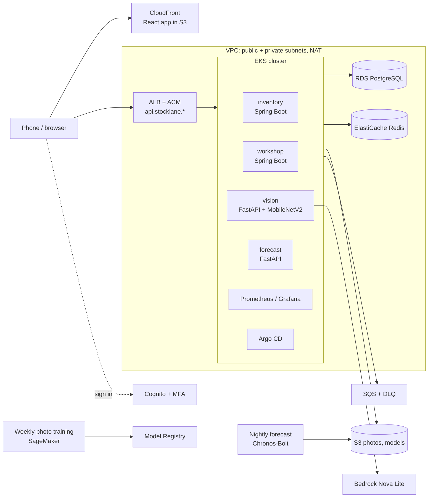
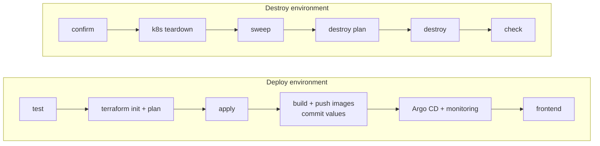

# Stocklane — workshop stock management on AWS

A stock-management system for a vehicle workshop, built around one problem: **parts go
missing and nobody knows who took them or when to reorder.** Everything that enters or
leaves the storeroom is recorded at the *storeroom counter* (received, given to a named
person, taken back), by scanning a QR label or taking a photo. The owner gets a plain
stock report and a reorder list that update by themselves.

It runs as microservices on **Amazon EKS**, is built entirely with **Terraform +
GitHub Actions + Argo CD**, and has **dev, staging and prod** environments that can each
be created and destroyed with one pipeline run.

## Architecture



- **Security:** private worker subnets, Pod Identity role per service account
  with a permissions boundary, Secrets Manager via External Secrets, KMS, network
  policies, non-root containers, Cognito with MFA.
- **Observability:** Prometheus, Alertmanager → SNS, Grafana dashboards,
  CloudWatch logs and alarms, a budget, and a Lambda that writes a root-cause
  summary when an alarm fires.
- **AI/MLOps:** a pretrained forecasting model, a photo matcher that retrains itself and
  Bedrock label reading, all with quality gates and no manual approval
  ([docs/MLOPS.md](docs/MLOPS.md)).

## Repository layout

```text
apps/web/                 React frontend
services/                 inventory, workshop (Spring Boot) · vision, forecast (FastAPI)
mlops/                    nightly forecast, weekly photo training, promotion
infra/
  ci/                     foundation: CI roles + state bucket (CloudFormation, once)
  terraform/modules/      network, data, registry, eks, workload-identity, edge,
                          auth, ml, observability, cicd
  terraform/environments/ dev · staging · prod (same main.tf, different tfvars)
deploy/
  helm/                   Helm charts (apps, platform, Argo CD, monitoring), per-environment values,
                          monitoring, vendored pinned upstream YAML
  docker/                 service and training images
  codebuild/              private in-VPC runner for the cluster bootstrap
scripts/                  pipeline steps (Python)
tests/                    pipeline, Terraform, Helm and ML safeguards
.github/workflows/        deploy, destroy, ci + reusable stages (_*.yml) + ML jobs
```

The same three names — `dev`, `staging`, `prod` — are used for the Terraform
environment, the Helm values file, the Kubernetes namespace (`stocklane-<env>`)
and the pipeline input.

| | dev | staging | prod |
| --- | --- | --- | --- |
| AZs / NAT | 2 / 1 shared | 2 / 1 shared | 3 / one per AZ |
| Nodes | 2 × m7i-flex.large | 2–3 × m7i-flex.large | 3–6 × m6i.large |
| Database | db.t4g.micro | db.t4g.small | db.t4g.small Multi-AZ |
| App replicas | 1 | 2 | 3 (HPA to 6) |
| `deletion_protection` | false | false | true |

## Pipelines



**One master pipeline creates everything; one destroys it.** Each stage is a
reusable workflow (`_terraform`, `_release`, `_platform`, `_frontend`,
`_cleanup`) so the master pipelines are just the order of stages.

| Stage | What happens |
| --- | --- |
| test | `ci.yml`: Java, frontend and Python tests; `terraform init -backend=false` + `validate` + a mocked plan for all three environments (checks the code only, touches no AWS); Helm lint, render and schema checks; actionlint; Trivy |
| init + plan | the real `terraform init` against the S3 state, then a plan saved privately with an ID and SHA256 |
| apply | applies **exactly** that saved plan (the hash is checked). This creates the ECR repositories, so images can only be pushed after it |
| build + push | builds the four service images, the web app and the photo-training image, pushes them to ECR by digest, renders the Helm values and commits them to `main` (GitOps) |
| Argo CD + monitoring | a private CodeBuild runner inside the VPC installs Argo CD; Argo CD syncs the release commit, including Prometheus, Alertmanager and Grafana; HTTPS probe |
| frontend | publishes the React build to S3 and invalidates CloudFront |

Destroy first removes what Kubernetes created in AWS (load balancers, volumes,
DNS records), then runs a reviewed `terraform destroy`, then **checks that
nothing billable is left**. Only the state bucket, CI roles and hosted zone stay.

Setup and usage: **[docs/DEPLOYMENT.md](docs/DEPLOYMENT.md)**.

## Spring Boot service structure

There are two Spring Boot microservices, `services/inventory` and
`services/workshop`. Each one is **self-contained** (its own `pom.xml`, security,
exception handling, migrations, Docker image and database schema) and has the
same layered layout:

```text
services/<service>/src/main
├── java/com/stocklane/<service>/
│   ├── <Service>Application     Spring Boot entry point
│   ├── controller/              REST endpoints and role checks (@PreAuthorize)
│   ├── service/                 business rules, transactions, calls to other services and AWS
│   ├── repository/              all SQL (JdbcTemplate), one class per table group
│   ├── dto/                     request bodies (Java records)
│   ├── config/                  SecurityConfig: Cognito JWT, service tokens, CORS
│   └── exception/               ConflictException (409), NotFoundException (404), GlobalExceptionHandler
└── resources/                   application.yml, db/migration (Flyway SQL)
```

Requests go `controller → service → repository → PostgreSQL`. The two services
call each other only over HTTP and an SQS-backed outbox (inventory events update
workshop job allocations). Routing between services is done by the ALB ingress,
so there is no separate API-gateway service.

`service/Commands` (idempotent requests: the same `Idempotency-Key` returns the
same result) and the `config` and `exception` classes are copied into both
services so that each can be built and deployed on its own. A test
(`tests/test_backend_structure.py`) keeps the copies identical and keeps SQL out
of controllers and services.

## Design decisions worth explaining

- **Modules + per-environment roots instead of workspaces.** Each environment has
  its own state file and its own small `terraform.tfvars`; the code is identical
  (a test enforces it), so differences between dev and prod are visible in one file.
- **Saved plans.** What gets applied is the plan that was reviewed, not a fresh
  one that could differ.
- **Private runner for the cluster.** The EKS API is restricted to the operator's
  IP, so cluster bootstrap runs on CodeBuild inside the VPC.
- **GitOps.** The pipeline never runs `kubectl apply` for apps; it commits the
  rendered values and Argo CD makes the cluster match Git.
- **Helm charts with vendored third-party manifests.** Our services are one chart with a values file
  per environment; third-party components are committed as chart files with every file SHA-pinned, so a
  deploy can only apply reviewed bytes ([docs/HELM.md](docs/HELM.md)).
- **One switch for disposability.** `deletion_protection=false` turns off DB
  snapshots, bucket retention and secret recovery windows so dev/staging destroy
  cleanly; prod keeps all of them.

## Models

| Model | What it does | How it runs |
| --- | --- | --- |
| Stock forecast | Pretrained **Chronos-Bolt** predicts how much of each item will be used | nightly job on a GitHub runner; each item is back-tested and released only if the test error is small; otherwise the reorder level is used |
| Photo matcher | MobileNetV2 features plus a calibrator trained on photos people confirmed | retrains every Sunday on SageMaker; approved and rolled out by itself only if it beats the served model |
| Label reading | Textract, then Bedrock tool use, suggests the name, brand and size | on demand, when a new item is photographed |

## Using it

There is no local setup. Push to `main`, run **Deploy environment**, open the app URL.
Argo CD and Grafana in dev and staging sign in with `admin` / `admin`.

## More docs

| Doc | Topic |
| --- | --- |
| [docs/DEPLOYMENT.md](docs/DEPLOYMENT.md) | One-time setup, deploy, destroy, troubleshooting |
| [infra/README.md](infra/README.md) | Terraform modules and environments |
| [docs/HELM.md](docs/HELM.md) | Helm charts, values, Argo CD |
| [docs/MLOPS.md](docs/MLOPS.md) | Models, nightly forecast, weekly photo training, Bedrock |
| [docs/OPERATIONS.md](docs/OPERATIONS.md) | Stock rules, alerts, recovery drills |
| [docs/WAREHOUSE_UX.md](docs/WAREHOUSE_UX.md), [docs/STOCK_ANALYSIS.md](docs/STOCK_ANALYSIS.md), [docs/DEMAND_FORECASTING.md](docs/DEMAND_FORECASTING.md) | Application features |
