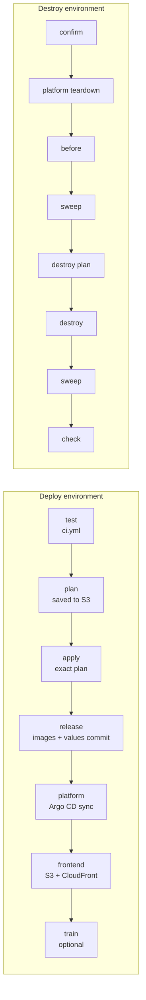

# Deploy and destroy an environment

Two GitHub Actions pipelines manage AWS:

| Pipeline | What it does | Time |
| --- | --- | --- |
| **Deploy environment** (`deploy.yml`) | Creates or updates `dev`, `staging` or `prod` from nothing: tests → Terraform init + plan → apply → build and push images → Argo CD and monitoring → frontend | ~45 min from empty |
| **Destroy environment** (`destroy.yml`) | Removes everything Deploy created so nothing keeps billing | ~25 min |

Everything else is a stage those two call (`_terraform`, `_release`, `_platform`,
`_frontend`, `_cleanup`, `ci`). The ML workflows (`forecast` every night, `train` every
Sunday, `release-model` after an approval) run by themselves and can also be run by hand.



## What is kept between deploys

Destroy removes the whole Terraform environment. It keeps only:

- the **foundation** CloudFormation stacks (`infra/ci/identity.json` roles and CI
  user, and the private Terraform state bucket) — free or a few cents;
- your **Route 53 hosted zone** (it is not managed by this project).

Models are **not** kept: a fresh environment starts with the checksum-pinned MobileNetV2
photo matcher and no forecast (the reorder-level rule applies until the first nightly run).
The photo model retrains itself weekly once people have confirmed enough photos.

## One-time setup (per environment)

### 1. GitHub environments

In **Settings → Environments** create `aws-bootstrap`, `aws-infrastructure-plan`,
`aws-infrastructure-apply`, `aws-release`, `aws-platform` and `aws-training`.
For each, set **Deployment branches → Selected branches** with one rule: `main`.
Add a **required reviewer** to `aws-infrastructure-apply` if you want a human
approval before every apply and destroy.

The release stage pushes the rendered Helm values to `main` as
`release(<env>): <sha> [skip ci]`. If `main` has branch protection, allow
GitHub Actions to push (or add it to the bypass list).

### 2. Foundation stack (AWS CloudShell, once per environment)

```bash
git clone https://github.com/<owner>/<repo>.git && cd <repo>
export AWS_REGION=ap-southeast-2 AWS_DEFAULT_REGION=ap-southeast-2

python3 scripts/bootstrap_pipeline.py \
  --repository <owner>/<repo> \
  --project-name stocklane-dev --environment dev \
  --auth-mode access-key \
  --expected-account <account-id> \
  --hosted-zone-id <zone-id> \
  --api-domain api.stocklane.<your-domain>
```

This creates a **change set only**. Review it, then repeat with `--execute`
(add `--create-access-key` only the very first time for that environment).
It writes two private files in `deploy/generated/` — never commit or paste them
publicly:

- `github-setup.json`: repository variables and the `TFVARS_JSON` value;
- `github-credentials.json`: the CI user's access key (first run only).

For `staging` or `prod`, run it again with `--project-name stocklane-staging
--environment staging` (or `prod`). Each environment gets its own roles, CI user
and state bucket.

When `identity.json` changes (as in this restructure), re-run the same command
with `--execute` but **without** `--create-access-key` to update the stack.

### 3. GitHub variables and secrets

Variables (**Settings → Secrets and variables → Actions → Variables**):

| Variable | Value |
| --- | --- |
| `AWS_ACCOUNT_ID` | your account ID |
| `AWS_AUTH_MODE` | `access-key` (or `oidc` where IAM OIDC providers are allowed) |

`PROJECT_NAME`, `TF_ENVIRONMENT` and `TF_STATE_BUCKET` are no longer needed: the
pipelines derive them from the environment you pick (`stocklane-<env>`).

Secrets, one set per environment:

| Environment | Terraform values | CI user key |
| --- | --- | --- |
| dev | `TFVARS_JSON` | `AWS_ACCESS_KEY_ID`, `AWS_SECRET_ACCESS_KEY` |
| staging | `TFVARS_JSON_STAGING` | `AWS_ACCESS_KEY_ID_STAGING`, `AWS_SECRET_ACCESS_KEY_STAGING` |
| prod | `TFVARS_JSON_PROD` | `AWS_ACCESS_KEY_ID_PROD`, `AWS_SECRET_ACCESS_KEY_PROD` |

`TFVARS_JSON` holds only **account-specific** values; sizes live in the committed
`infra/terraform/environments/<env>/terraform.tfvars`. Start from
`repository_secret.value` in `github-setup.json` and add your domains:

```json
{
  "administrator_arn": "arn:aws:iam::<account>:role/<your-operator-role>",
  "operator_cidrs": ["<your-public-ip>/32"],
  "admin_allowed_cidrs": ["<your-public-ip>/32"],
  "route53_zone_id": "<zone-id>",
  "api_domain": "api.stocklane.<your-domain>",
  "web_domain": "stocklane.<your-domain>",
  "argocd_domain": "argocd.stocklane.<your-domain>",
  "grafana_domain": "grafana.stocklane.<your-domain>",
  "budget_email": "<you@example.com>",
  "github_oidc_subject_style": "immutable",
  "github_auth_mode": "access-key",
  "bedrock_model_id": "amazon.nova-lite-v1:0",
  "bedrock_region": "us-east-1"
}
```

The pipeline adds the repository IDs, CI user ARN and permissions-boundary ARN
itself, so they are not in the secret.

Every hostname must contain `stocklane` (the CI roles may only write DNS records
matching `*stocklane*.<zone>`). Use different names per environment, for example
`api.stocklane-staging.<your-domain>`.

## Sign-in after a deploy

- **App:** Terraform creates the first **OWNER** user from `initial_owner_email` in
  `TFVARS_JSON` (it falls back to `budget_email`) and Cognito emails a temporary
  password. Sign in, choose a new password (14+ characters) and set up an
  authenticator app for MFA. Nothing needs creating by hand, so a destroy followed
  by a deploy brings back a working login.
- **Argo CD and Grafana:** `dev` and `staging` use **admin / admin**
  (`demo_admin_credentials = true` in their `terraform.tfvars`). `prod` keeps
  generated passwords. Both dashboards are reachable only from the addresses in
  `admin_allowed_cidrs`, so keep that list to your own IP.

## Deploy

**Actions → Deploy environment → Run workflow** on `main`:

- `environment`: `dev`, `staging` or `prod`
- `train`: also run the SageMaker jobs at the end
- `model_package`: optional approved Model Registry ARN to serve
- `allow_deletions`: leave off. If an update plan would delete or replace a
  resource, the apply stops; read the plan summary in the run, then re-run with
  this on if the change is intended

The run summary prints the app, API, Argo CD and Grafana URLs. Running Deploy
again on a live environment is a normal update: Terraform only changes what
differs and Argo CD rolls out the new release commit.

Deploy and Destroy share one queue, so only one runs at a time (a saved plan is
only applied while `main` is still at the commit it was planned from).

## Try the AI features

1. **AI label suggestions:** in the app choose **Receive stock → register a new
   item**, add a photo of a product label and use the AI suggestion. It calls
   `amazon.nova-lite-v1:0` in `us-east-1` (`bedrock_region`) and is limited to 50
   uncached requests per day. If Bedrock is unavailable (for example the account has
   no Bedrock quota yet), the app **falls back to Amazon Textract**, which reads the
   printed text and fills in name, brand, part number, category, grade and capacity.
   Fields it cannot read are left blank and a person reviews every draft. The fallback
   is on by default (`TEXTRACT_FALLBACK`) and the status endpoint still reports the
   real Bedrock problem. The first time you use it, re-run the CloudShell bootstrap
   (without `--create-access-key`) so the IAM boundary allows `textract:DetectDocumentText`.
2. **Models:** nothing to do. The forecast runs every night and the photo model retrains every
   Sunday (see [MLOPS.md](MLOPS.md)). Make sure the `aws-training` GitHub environment has no
   required reviewers, or the scheduled runs would wait for an approval. Run **Nightly stock
   forecast** or **Train reviewed workshop model** by hand only to see a result sooner.

## Destroy

**Actions → Destroy environment → Run workflow**, pick the environment and type
its name again in `confirm`. The final `check` job fails if any EKS cluster, RDS
instance, Redis cluster, NAT gateway, Elastic IP, VPC, load balancer or EBS
volume of that environment is still present.

`prod` has `deletion_protection = true`, so its database refuses deletion and
Destroy stops at the apply stage. Set it to `false` in
`environments/prod/terraform.tfvars` in a reviewed commit first if you really
mean to remove production.

## Troubleshooting

- **State lock left by a cancelled run:** delete
  `state/<env>/terraform.tfstate.tflock` from that environment's state bucket,
  then re-run.
- **A destroy stage failed half way:** re-run **Destroy environment**. Every
  clean-up step is idempotent and runs even if the cluster is already gone.
- **EKS API unreachable from your machine:** `operator_cidrs` must contain your
  current public IP. The pipeline itself reaches the cluster from the private
  CodeBuild runner inside the VPC.
