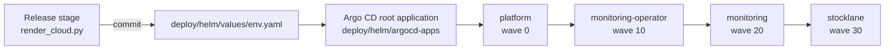

# Kubernetes delivery with Helm and Argo CD

Everything that runs in the cluster is a **Helm chart** under `deploy/helm/`. Argo CD renders the
charts from Git (GitOps); the bootstrap uses `helm template` and `kubectl apply` once, so Argo CD can
take over the same objects. Terraform creates EKS, IAM, RDS, S3, ElastiCache and the other AWS services.

## Charts

| Chart | Contents | Installed into |
| --- | --- | --- |
| `stocklane` | The four services (inventory, workshop, vision, forecast): Deployment, Service, ServiceAccount, HPA, PDB, ServiceMonitor, ExternalSecret; shared ConfigMap, ALB Ingress, NetworkPolicies, the model-index PreSync Job | `stocklane-<env>` |
| `platform` | cert-manager, External Secrets, AWS Load Balancer Controller, metrics-server, Fluent Bit, gp3 StorageClass, optional admin Ingresses | cluster (`kube-system`, ...) |
| `argocd` | Argo CD, with the health check that lets the root application wait for its children | `argocd` |
| `monitoring-operator` | Prometheus Operator and its CRDs | `monitoring` |
| `monitoring` | Prometheus, Alertmanager, Grafana, dashboards, alert rules, kube-state-metrics | `monitoring` |
| `bootstrap` | The one-off database initialisation Job | `stocklane-<env>` |
| `argocd-apps` | The Argo CD projects and applications of one environment (app of apps) | `argocd` |

One values file per environment, `deploy/helm/values/<env>.yaml`, feeds every chart. The release stage
(`scripts/render_cloud.py`) writes it: image digests, domains, ARNs, queue URLs, replicas, model URI. The files
committed in the repository are placeholders until a release replaces them.

## How a chart reaches the cluster

1. **Bootstrap (once, from the private CodeBuild runner).** `scripts/bootstrap_eks.py` renders each chart with
   `helm template ... --include-crds` and applies it in a safe order (namespaces, CRDs, controllers, secret store,
   Argo CD, monitoring, database job) with server-side apply under the field manager `argocd-controller`, then creates
   the root Application from `deploy/helm/root/<env>.yaml`.
2. **GitOps (every release).** The root Application renders `argocd-apps`, which creates one Application per chart
   (`helm.valueFiles: ../values/<env>.yaml`). Argo CD syncs them in wave order and keeps them in line with Git.
3. **Model releases** change only `config.MODEL_URI` and its checksum in the values file; the pod template carries a
   checksum of the configuration, so pods roll when it changes.

## Why the third-party charts are local

Argo CD, cert-manager, External Secrets, the AWS Load Balancer Controller, metrics-server, kube-state-metrics and the
Prometheus Operator are committed as chart files (`files/`, and `crds/` for custom resource definitions), one resource
per file, with the namespace set. `deploy/helm/upstream.lock.json` records each bundle's version, download URL and source
checksum, plus the SHA256 of every committed file; CI fails if one changes. A deploy therefore applies only bytes that
were reviewed, and nothing is fetched from a chart repository at deploy time. The few parts that depend on the
environment (cluster name, region, VPC, log group, admin hosts, replica counts, secret ARNs) are real templates.

Upgrading a component means re-importing its manifests and updating the lock; it is a reviewed change, not a version
bump.

## Environments

| | dev | staging | prod |
| --- | --- | --- | --- |
| Namespace | `stocklane-dev` | `stocklane-staging` | `stocklane-prod` |
| App replicas / HPA maximum | 1 / 2 | 2 / 4 | 3 / 6 |
| Prometheus / Alertmanager replicas | 1 / 1 | 1 / 1 | 2 / 3 |

## Checks

`python scripts/validate_helm.py` (CI job `helm`) renders every chart for every environment and checks:
the pinned files against the lock; custom resources against the vendored CRD schemas; built-in resources with
`kubeconform` for Kubernetes 1.35; non-root, read-only containers; HTTPS ingress; no committed Secret values;
`helm lint`. With `--configured` it also rejects any placeholder left in a release. `tests/test_helm.py` covers the
environment differences, admin access, monitoring and the lock.

## Sign-in to the tools

Argo CD and Grafana use `admin` / `admin` in dev and staging (set by the bootstrap when `demo_admin_credentials` is true).
Production uses generated credentials.
