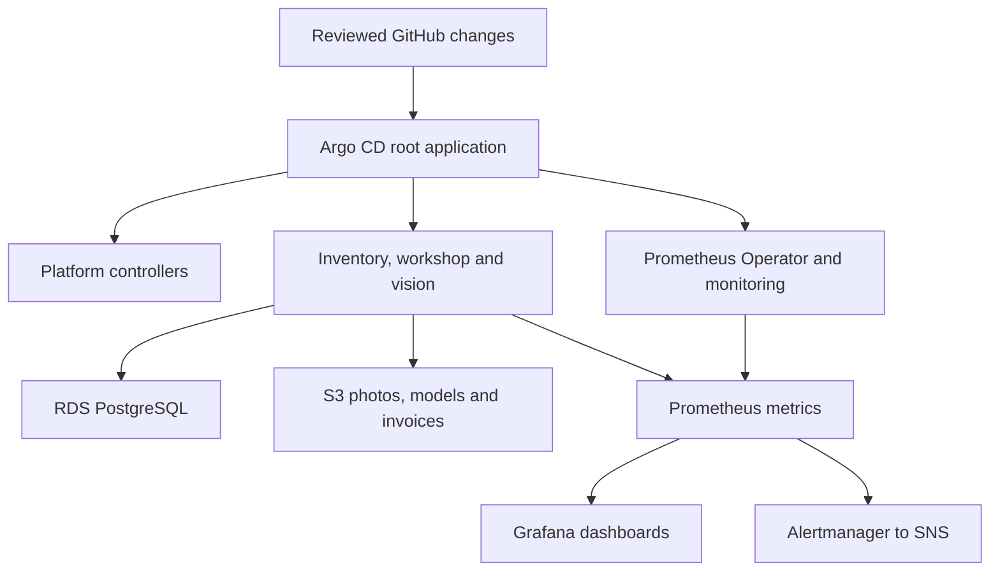

# EKS GitOps architecture with separate YAML files

The application, Argo CD, Prometheus Operator, Prometheus, Alertmanager, Grafana
and cluster add-ons are delivered as plain Kubernetes YAML with Kustomize.
Helm is not required in the deployment workflow (see *Why vendored YAML instead
of Helm* below). Terraform creates EKS, IAM,
RDS, S3, ElastiCache and the other AWS services.

## Resource layout

| Location | Contents |
| --- | --- |
| `deploy/kubernetes/apps/base/inventory/` | `deployment.yaml`, `service.yaml`, `serviceaccount.yaml`, `external-secret.yaml`, `hpa.yaml`, `pdb.yaml`, `servicemonitor.yaml`. |
| `deploy/kubernetes/apps/base/workshop/` | The corresponding job/invoice service resources. |
| `deploy/kubernetes/apps/base/vision/` | The vision service resources, model init container and temporary model volume. |
| `deploy/kubernetes/apps/base/shared/` | Separate ConfigMap, ALB Ingress and NetworkPolicy YAML. |
| `deploy/kubernetes/apps/base/model-index/job.yaml` | Argo CD PreSync model-index preparation job. |
| `deploy/kubernetes/apps/overlays/` | `dev`, `staging`, `prod`: namespaces and per-resource patches. |
| `deploy/kubernetes/platform/` | EBS `storageclass.yaml`, External Secrets store, ALB configuration, metrics server and Fluent Bit. |
| `deploy/kubernetes/argocd/base/` | Pinned Argo CD installation and child-application health configuration. |
| `deploy/kubernetes/argocd/applications/` | Separate AppProject and Application YAML, with an overlay per environment. |
| `deploy/kubernetes/argocd/root/` | One root Application file per environment. |
| `deploy/kubernetes/monitoring-operator/` | Monitoring namespace, Prometheus Operator CRDs and controller. |
| `deploy/kubernetes/monitoring/base/` | Separate Prometheus, Alertmanager, RBAC, rules, Services and Grafana resources. |
| `deploy/kubernetes/monitoring/base/grafana/` | Deployment, Service, PVC, ExternalSecret, datasource and dashboard ConfigMaps. |
| `deploy/kubernetes/bootstrap/` | Initial database bootstrap Job, ServiceAccount and environment configuration. |
| `deploy/kubernetes/vendor/` | Version-pinned upstream resources, split into one resource per YAML file. |

Each resource file contains one Kubernetes object. Kustomize combines these
files only when building/applying an overlay; there is no generated application
`resources.yaml` bundle to edit or commit.



## Environments

| Overlay | Application namespace | App replicas / HPA maximum | Prometheus / Alertmanager replicas |
| --- | --- | --- | --- |
| dev | `stocklane-dev` | 1 / 2 | 1 / 1 |
| staging | `stocklane-staging` | 2 / 4 | 1 / 1 |
| prod | `stocklane-prod` | 3 / 6 | 2 / 3 |

The overlay names match the Terraform environments in
`infra/terraform/environments/`. Each environment is its own EKS cluster with its
own Terraform state, so **Deploy environment** with `staging` creates a separate
stack (`stocklane-staging`) and renders `overlays/staging` for it.

All overlays retain Cognito, TLS, private data services and cloud authentication.
Development on AWS does not enable the local demo identity header.

## Storage and secrets

- Grafana has its own `pvc.yaml`, using the encrypted `gp3` StorageClass.
- Prometheus and Alertmanager use per-replica `volumeClaimTemplate` storage in
  their custom resource YAML. Their operator creates StatefulSets and PVCs.
- EBS CSI dynamically provisions PVs. A handwritten, fixed-volume `pv.yaml` is
  unnecessary. `WaitForFirstConsumer` aligns each volume with its pod's zone.
- The StorageClass uses `Retain`. Released volumes require an explicit cleanup
  decision and may continue to incur storage charges.
- Application stock, photos and invoices persist in RDS/S3. Application pods
  use temporary volumes for model downloads and scratch files.
- Application and Grafana credentials are created through External Secrets from
  Secrets Manager. Plaintext passwords are not committed.
- Alertmanager's `secret.yaml` contains only routing configuration; it uses Pod
  Identity to publish to SNS and contains no AWS access keys.

## Build and validation

From the repository root:

```bash
pip install -r scripts/requirements.txt
python scripts/install_kustomize.py --directory "$PWD/deploy/generated/tools"
export PATH="$PWD/deploy/generated/tools:$PATH"
python scripts/validate_kustomize.py
kustomize build deploy/kubernetes/apps/overlays/prod
```

The validator builds all environment layouts, checks pinned vendor file hashes,
validates custom resources against the vendored CRD schemas, and verifies
namespace isolation, Service selectors, HPA targets and workload safeguards.
A separate CI `kustomize` job runs these checks and kubeconform checks for
Kubernetes 1.35 built-in resource schemas. Custom kinds are validated against
the vendored CRD schemas.

The checked-in example overlays contain `REPLACE_...` metadata and unreleased
application image names. They are not an account-specific deployment. The
release helper writes actual Terraform outputs, immutable image digests and
model checksums to per-resource patches. It then runs:

```bash
python scripts/validate_kustomize.py --environment prod --configured
```

This gate rejects placeholder runtime values, mutable application images and
an inconsistent environment/model release. Configuration checksums in pod
annotations trigger rollouts when the model/configuration changes. The PreSync
index job receives the new model URI/checksum explicitly, because the shared
ConfigMap is updated later in the Sync phase.

## Why vendored YAML instead of Helm

Third-party components are copied into `deploy/kubernetes/vendor/` as plain
YAML, one object per file, and every file's SHA256 is pinned in
`upstream.lock.json`. Compared with installing Helm charts at deploy time:

- a deploy can only apply bytes that were reviewed in Git (supply-chain lock);
- the private CodeBuild runner inside the VPC needs no chart repository access;
- `kustomize build` shows the exact objects, so diffs in a pull request are real.

The trade-off is that upgrades mean re-vendoring the files and updating the lock
in one reviewed pull request.

## Initial bootstrap and Argo CD

The **Deploy environment** pipeline runs this inside the VPC on the private
CodeBuild runner (`scripts/run_platform_bootstrap.py` → `scripts/bootstrap_eks.py`)
right after the release commit is pushed.

The helper checks the AWS account and configured overlays, applies namespaces
and CRDs with server-side apply, waits for controllers and webhooks, initialises
the service-owned databases, and creates the selected root Argo CD Application.
No Helm command runs in this bootstrap.

The root references child Applications in initial sync-wave order: platform,
monitoring operator, monitoring, then workshop workloads. Child health is exposed
to the root through the Argo CD ConfigMap. For later controller/CRD upgrades,
sync the controller application and verify readiness before updating dependent
custom resources. Independent child auto-sync is not a global transaction.

Do not grant normal application developers permission to edit platform
Applications or AppProjects. A private Git repository needs a read-only Argo CD
repository credential configured by the owner.

Private administrative interfaces:

```bash
kubectl -n argocd port-forward svc/argocd-server 8443:443
kubectl -n monitoring port-forward svc/grafana 3000:80
kubectl -n monitoring port-forward svc/prometheus 9090:9090
```

Retrieve Grafana's generated administrator credentials from the `grafana-admin`
Kubernetes Secret on your own operator machine. Treat the result as a password.
Grafana stores its administrator account in its database; changing the initial
password Secret later requires Grafana's supported password-reset procedure.

## Scope of verification

Builds and schema/policy checks are offline checks. They do not establish an
AWS deployment, live webhook compatibility, image-pull access, successful EBS
provisioning, database connectivity, restore targets or a production SLO. Those
remain acceptance checks in the authenticated AWS environment.
