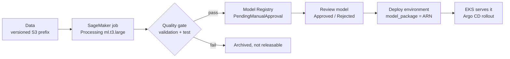

# AI and MLOps

Stocklane uses three kinds of AI. Live inference always runs on EKS; SageMaker
is used only for short, bounded jobs, so nothing keeps billing between demos.

| Feature | Model | Where it runs |
| --- | --- | --- |
| Find an item from a photo | Frozen MobileNetV2 embeddings + a trained same-SKU calibrator | Vision service on EKS |
| Stock usage forecast | Weekday baseline or Ridge model, chosen by a quality gate | Forecast service on EKS (batch forecasts from S3) |
| Read a label into a draft item | Amazon Bedrock `amazon.nova-lite-v1:0` (Converse API) | Called on demand from the Vision service |

## Lifecycle

1. **Data.** Reviewed photos (`manifest.csv` + images) are uploaded with
   `mlops/upload_dataset.py` to a content-addressed, checksummed S3 prefix.
   Public benchmark inputs (`datasets/public-benchmark/`) are licensed,
   checksum-pinned and downloaded by the workflow.
2. **Train.** `train.yml` (your photos), `forecast.yml` (stock history) or
   `train-public-data.yml` (public benchmark; also the `train` option of
   Deploy). Jobs run as **SageMaker Processing jobs on `ml.t3.large`** because
   new accounts usually have zero training-instance quota. Set
   `SAGEMAKER_JOB_TYPE=training` to use real training jobs once you have quota.
   Each job has a runtime limit and network isolation; no endpoint is created.
3. **Gate.** The threshold is chosen on the validation split and judged on an
   independent test split (photo precision ≥ 98 %, recall ≥ 50 %; the forecast
   model must beat its baseline). A failing run cannot register a releasable
   model.
4. **Register.** Passing models become `PendingManualApproval` versions in
   `stocklane-<env>-visual-sku` or `stocklane-<env>-stock-forecast`.
5. **Approve.** Run **Review SageMaker model** with the package ARN.
6. **Release.** Run **Deploy environment** with `model_package` set to that ARN.
   `mlops/promote.py` checks approval, quality flags and checksum, copies the
   bundle to the release prefix, and the release commit pins it. Roll back by
   deploying a previously approved ARN — no retraining.

## Guard rails

- Synthetic or public-benchmark artifacts can never reach the live app: the
  uploader, the review workflow, promotion and both EKS model loaders reject them
  (`tests/test_synthetic_guards.py`, `tests/test_public_data.py`).
- A person always confirms stock movements; similarity scores are not
  confidence percentages.
- Bedrock may only suggest visible label fields. It cannot change quantities or
  approve items. Requests are cached for 15 minutes and limited to 50 uncached
  calls per UTC day (`bedrock_daily_request_limit`), shared across replicas.

## Bedrock region

The Sydney account has zero Bedrock quota, so calls go to **us-east-1**
(`bedrock_region` in `TFVARS_JSON`). The Vision pod's Pod Identity role is
allowed to invoke only that one model in that region; no API key is used.

## Public benchmark results (measured locally)

| Check | Result |
| --- | --- |
| Photo test precision / recall | 0.385 / 0.071 — gate failed |
| Monthly forecast: Ridge MAE vs best baseline | 0.736 vs 0.670 — gate failed |

These show the gates working: a trained model that is worse than a simple
baseline is not released. Real workshop photos and stock history are needed for
a production-quality model.

## What to show in an interview

| Step | Where | What it proves |
| --- | --- | --- |
| Label suggestion | App → register item → AI suggestion | Bedrock call from EKS with Pod Identity, no API key |
| Train | Actions → *Train real-data ML models* | SageMaker jobs from CI, quality gates, nothing left running |
| Registry | SageMaker → Model Registry | Versioned, reviewable models in `PendingManualApproval` |
| Release gate | `mlops/review_model.py`, `promote.py` | Benchmark and synthetic models cannot reach production |
| Photo matching | App → Find an item | MobileNetV2 baseline served from EKS |

To serve a *trained* photo model you need real workshop photos: collect a reviewed
dataset, upload it with `mlops/upload_dataset.py`, run **Train reviewed workshop
model**, approve the version, then deploy with its `model_package` ARN.
