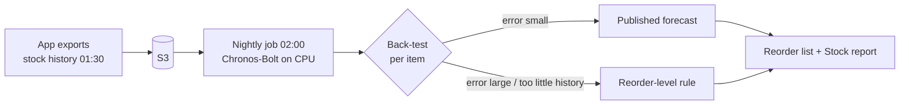

# AI and MLOps

Three kinds of AI, none of them needing a manual step. Live inference runs on EKS; SageMaker
is used only for the weekly photo training, so nothing keeps billing in between.

| Feature | Model | Where it runs |
| --- | --- | --- |
| Stock forecast (what to reorder) | Pretrained **Chronos-Bolt** (`amazon/chronos-bolt-small`), used as it is | Nightly job on a GitHub runner; results are read by the forecast service on EKS |
| Find an item from a photo | Frozen MobileNetV2 features + a same-item calibrator trained on photos people confirmed | Vision service on EKS; retrained weekly on SageMaker |
| Read a label into a draft item | Textract first, then Amazon Bedrock Nova Lite (Converse API with tool use) for missing fields | On demand from the Vision service |

## Forecast: a pretrained model, nothing to train

1. The inventory service writes each item's daily use to S3 every night. Days when an item was
   out of stock are filled with its in-stock average, so a stock-out is not read as "no demand".
2. The nightly job (`forecast.yml`, `mlops/run_forecast.py`) gives Chronos-Bolt each item's history.
3. **Back-test gate.** For every item the model first forecasts the item's own most recent days
   (seven to 28) from the days before them. If the error (WAPE) is above 60 %, that item's forecast
   is not released. The model never sees the days it is tested on.
4. Released forecasts give "runs out in about N days" and an order quantity. Everything else
   (fewer than 21 days of history, or irregular use) uses the **reorder-level rule**: when stock is at or
   below the item's reorder level (5 by default), order enough to reach double that level.
5. If the job fails, yesterday's forecast stays. Nothing here changes stock.

The first day works without any history: every item uses the reorder-level rule, and items move to
the forecast one by one as their history grows.

## Photo matcher: retrains itself

| When | What happens by itself |
| --- | --- |
| Every Sunday 01:00 (Asia/Colombo) | The vision service exports every photo a person confirmed (new items and parts identified at the storeroom counter) as a dataset. It starts once there are at least 60 photos, with 15 photos across 3 items in each split. |
| Every Sunday 02:30 | `train.yml` trains the calibrator on that export, but only if the photos changed (`mlops/workshop_dataset.py`). It runs as a **SageMaker Processing job on `ml.t3.large`**, because new accounts usually have zero training-instance quota. |
| After training | `mlops/auto_promote.py` approves the new version only if it passed the quality gate **and** beats the model being served (higher test F1, precision at least 98 %). Otherwise it is rejected with the reason. |
| After approval | `release-model.yml` commits the model to the environment's overlay and Argo CD rolls it out (GitOps). |

The quality gate picks its threshold on a validation split and judges on an independent test split:
precision at least 98 %, recall at least 50 %. Until the first model passes, the pretrained MobileNetV2
matching with a fixed similarity limit is used.

GitHub pauses scheduled workflows after 60 days without commits; a push re-enables them. The
`aws-training` GitHub environment must not have required reviewers, or the scheduled runs would wait.

## Guard rails

- A person always confirms stock movements; similarity scores are not confidence percentages.
- Bedrock may only suggest visible label fields. It cannot change quantities or approve items.
  Requests are cached for 15 minutes and limited to 50 uncached calls per UTC day
  (`bedrock_daily_request_limit`), shared across replicas. When Bedrock is unavailable, Textract's
  text reading still fills what it can and the app says no suggestion is available.
- Model files are checksum-verified before use (`.safetensors` for Chronos; ONNX with a pinned SHA256 for the encoder).

## Bedrock region

The Sydney account has zero Bedrock quota, so calls go to **us-east-1** (`bedrock_region` in
`TFVARS_JSON`). The Vision pod's Pod Identity role may invoke only that one model in that
region; no API key is used.

## What to show in an interview

| Step | Where | What it proves |
| --- | --- | --- |
| Nightly forecast | Actions → *Nightly stock forecast* → summary | A foundation model in production without training, with a per-item back-test gate and a safe fallback |
| Weekly photo training | Actions → *Train reviewed workshop model* | Scheduled training on data the app collected itself |
| Registry and auto approval | SageMaker → Model Registry, `mlops/auto_promote.py` | Versioned models; approval is a measured rule, not a click |
| GitOps release | Actions → *Release approved model*, then Argo CD | The model reaches the cluster as a Git commit |
| Label suggestion | App → register item | Textract then Bedrock tool use from EKS with Pod Identity, no API key |
