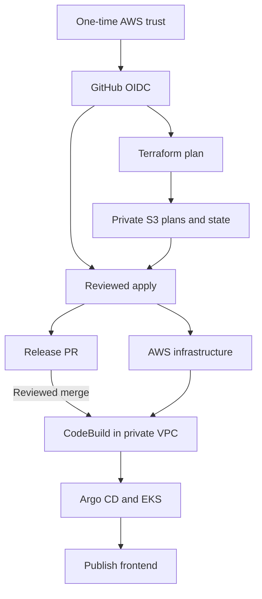

# Automated AWS delivery in Sydney

This is the default deployment procedure. Keep the current AWS Free plan and
Sydney (`ap-southeast-2`). No Paid plan, advanced-feature activation or SCP
changes are part of this setup.

The code is prepared for your repository:
`bawantha395/workshop-stock-management--system-mlops`.

## What runs automatically

| Workflow | Trigger | Result |
| --- | --- | --- |
| Validate platform | Push to main or pull request | Application tests, infrastructure checks, security scan, Kustomize validation and automation tests. |
| Bootstrap Terraform backend | Run workflow once | Creates a private, encrypted, versioned S3 backend through CloudFormation; conditionally seeds empty state without overwriting existing state. |
| Plan AWS infrastructure | Relevant main changes or Run workflow | Produces a Terraform plan, private S3 plan/version/provider lock, and a review summary. |
| Apply reviewed Terraform plan | Run workflow with Plan ID and SHA256 | Applies that exact current plan after identity, age, checksum, provider-lock and input checks. Deletes/replacements require an additional explicit input. |
| Prepare AWS release | Successful CI for app changes, after apply, or Run workflow | Builds immutable ECR images, stages frontend/model artifacts and opens a GitOps release PR. |
| Bootstrap EKS platform | Successful CI after GitOps merge, or Run workflow | Submits the reviewed source to CodeBuild inside the VPC; installs/controllers and monitoring, waits for Argo CD/application readiness and configures API DNS. |
| Publish reviewed frontend | Dispatched after successful platform bootstrap, or Run workflow | Publishes the checksum-verified frontend to S3/CloudFront. |
| Train reviewed workshop model | Run workflow with reviewed dataset and image | Runs bounded SageMaker training/evaluation and registers passing results pending model approval. |

Terraform applies and release merges are deliberate review steps. There is no
automatic destroy workflow. Routine Kubernetes reconciliation is handled by
Argo CD using Kustomize.



## 1. Upload this complete update and pass CI

Merge the ZIP contents into your existing Git checkout, keeping its Git
metadata. Include the new `.github/workflows/`, `infra/ci/`, `infra/aws/`,
`scripts/`, `deploy/codebuild/` and tests. Commit and push to the existing
repository. Do not nest a second project folder inside the repository.

Wait for **Validate platform**. It now has **eight jobs**, including
`automation`. The infrastructure job must pass Terraform validation in GitHub
before AWS deployment. The AWS plan/platform jobs skip until repository
variables are configured.

## 2. Create six GitHub environments with main-only deployment rules

In the repository, open **Settings → Environments** and create:

- `aws-bootstrap`
- `aws-infrastructure-plan`
- `aws-infrastructure-apply`
- `aws-platform`
- `aws-release`
- `aws-training`

For **each** environment, set **Deployment branches and tags → Selected branches
and tags**, then add exactly one **Branch** rule named `main`. Do not add a
tag rule or wildcard rule.

The AWS bootstrap helper checks these rules through GitHub before creating
trust. For a public repository it can use public API access. If GitHub requires
authentication or its anonymous rate limit has been reached, supply a temporary
`GH_TOKEN` with permission to read this repository's environments in the
CloudShell session; the helper never prints or stores it. This is a GitHub
token, not an AWS access key.

Protect main with the CI checks and code review. Add a required reviewer to
`aws-infrastructure-apply` when another maintainer is available. The apply
workflow itself always requires a manual dispatch with the exact Plan ID and
SHA256, even without an environment reviewer.

## 3. Run the one-time AWS trust setup

GitHub needs an initial AWS trust relationship before it can create resources.
Use your existing authenticated CloudShell session for this step.

The helper uses CloudShell's preinstalled Python/Boto3. Terraform installation
and application dependency installation are not needed for this helper.

```bash
cd ~/workshop-stock-management--system-mlops
git pull --ff-only

export AWS_REGION=ap-southeast-2
export AWS_DEFAULT_REGION=ap-southeast-2

python3 scripts/bootstrap_pipeline.py \
  --repository bawantha395/workshop-stock-management--system-mlops \
  --project-name stocklane-dev \
  --environment dev \
  --capacity-profile demo \
  --region ap-southeast-2 \
  --expected-account 721274598579 \
  --hosted-zone-id Z035879924YQHJ4M5G2A3 \
  --api-domain api.stocklane.bawantha-rathnayake.tech
```

Enter your budget-alert email when asked. It is saved to private local setup
output, not committed.

By default the helper creates a **reviewable CloudFormation change set only**.
Inspect its resource changes and the permissions in `infra/ci/identity.json`.
It contains three IAM roles, a workload permissions boundary and, if needed,
a shared GitHub OIDC provider.
It does not create EKS, databases or a state bucket.

After review, repeat the same command with `--execute` appended to create the
trust resources and wait for completion. This is the one-time operator
authorization for GitHub infrastructure automation.

The helper preserves the real operator IAM path, including
`arn:aws:iam::721274598579:role/managed/AccountFullAccessRole`, detects the
current CloudShell public IP, verifies your public DNS zone, and obtains the
GitHub repository/owner IDs for immutable OIDC subjects.

The provisioning role is powerful: it can manage the listed platform services
in Sydney. Its IAM role writes, application buckets and DNS writes are scoped
to this project; its own CI roles and state-bucket governance are protected.
The plan role can read project secret versions/state for Terraform refresh.
Use these roles only with reviewed main source and the protected environments.
The bootstrap stack does not grant `AdministratorAccess` or modify SCPs.
Terraform-created roles must carry the workload boundary. The apply role cannot
remove or edit that boundary, and workload roles cannot administer IAM or access
the CI state bucket through their identity permissions.

## 4. Copy the generated GitHub settings

The helper creates this ignored, private local file:

`deploy/generated/github-setup.json`

View it in CloudShell:

```bash
cat deploy/generated/github-setup.json
```

In **Settings → Secrets and variables → Actions → Variables**, create each
entry under `repository_variables`. Typical values for this account are:

| Variable | Value |
| --- | --- |
| `AWS_ACCOUNT_ID` | `721274598579` |
| `AWS_REGION` | `ap-southeast-2` |
| `PROJECT_NAME` | `stocklane-dev` |
| `TF_ENVIRONMENT` | `dev` |
| `TF_STATE_BUCKET` | `stocklane-dev-tfstate-721274598579-ap-southeast-2` |
| `OIDC_SUBJECT_STYLE` | `immutable` for this newly created repository; use the helper's actual output |

Under **Secrets**, create **`TFVARS_JSON`**. Paste only the JSON object under
`repository_secret.value`, including its braces.

The object contains account configuration and a budget email, not AWS
credentials. Workflows derive role ARNs from the account/project, and supply
the exact GitHub owner/repository IDs automatically.

No `AWS_ACCESS_KEY_ID`, `AWS_SECRET_ACCESS_KEY`, session tokens or manually
copied database passwords are required in GitHub.

## 5. Bootstrap the backend through GitHub

Open **Actions → Bootstrap Terraform backend → Run workflow → main**.

This workflow owns the S3 backend through a separate CloudFormation stack.
Its empty initial state is uploaded with `If-None-Match: *`. Existing state is
preserved on retries. Bucket versioning, encryption, HTTPS-only access and all
public-access blocks are checked before planning.

If a bucket with this exact name already exists outside that CloudFormation
stack, the workflow stops; import/adopt it deliberately instead of deleting
state. The previous optional manual Terraform bootstrap is not part of this
pipeline procedure.

## 6. Generate and review the first plan

Open **Actions → Plan AWS infrastructure → Run workflow → main**.

The job summary gives a **Plan ID**, commit SHA, **Plan SHA256**, and resource
action counts/addresses. Terraform's normal redacted plan is in the job log.
Budget email and operator CIDRs are masked. Binary plans, provider locks and
state are kept in private S3; they are not uploaded as GitHub artifacts.

Read the proposed resources and capacity before applying. The default demo
profile is:

| Resource | Demo setting |
| --- | --- |
| Availability Zones | 2 |
| NAT gateways | 1 |
| EKS workers | 2 × `t3.large`; maximum 2 |
| Application replicas | 1 each |
| RDS | Single-AZ `db.t4g.small` |
| Redis | 2 × `cache.t4g.micro`, with failover |
| Platform bootstrap | On-demand, non-privileged CodeBuild Small; maximum 45 build minutes |

This keeps the requested AWS architecture with lower demo capacity. It is not
the production availability profile. `infra/ci/capacity-production.json`
retains three AZs/NATs/workers, replicated application capacity and Multi-AZ
RDS.

**Free plan does not make the stack free.** EKS, workers, NAT, RDS, Redis,
ALB, storage and build minutes consume eligible credits. AWS quotas and
Free-plan service restrictions still apply. A successful plan is not proof of
capacity availability or production readiness. Use bounded deployment sessions
and review the regional cost estimate before apply.

## 7. Apply the exact reviewed plan

Open **Actions → Apply reviewed Terraform plan → Run workflow → main**.

- Paste the Plan ID and Plan SHA256 from the plan summary.
- Keep `allow_deletions` false for the first deployment.
- Leave `prepare_release` true to start release preparation after a successful apply.

The workflow checks the account, Region, environment, source SHA, plan age
(maximum six hours), S3 object version, plan checksum, provider lock and current
input hash. It applies the saved plan with state locking. It does not generate
a replacement plan during approval.

If main, inputs or Terraform state changed, generate a new plan. After a
partial apply or deployment-output publication failure, also generate a fresh
plan before retrying; do not repeatedly apply an old plan.

After success, non-secret deployment outputs are published privately in the
automation bucket. Release/training/platform workflows read those outputs
directly. There is no `DEPLOYMENT_JSON` copy/paste step.

## 8. Review the release PR and let the platform pipeline run

**Prepare AWS release** builds images/model artifacts and opens a GitOps PR.
Enable **Allow GitHub Actions to create and approve pull requests** in the
repository's Actions settings if GitHub blocks PR creation.

Application-only changes automatically prepare releases after successful main CI.
Mixed infrastructure/application changes wait for reviewed infrastructure apply.
GitOps-only commits do not start another image build, avoiding a release loop.
Application releases retain the previously reviewed model; a new package ARN is
required to deliberately change trained model versions. Retained packages with
recorded provenance are rechecked for approval.

Review the release changes, including image digests/model versions. Merge the
PR when checks and review are complete. The release job explicitly dispatches **Validate platform** on its generated
GitOps branch, so CI checks can run with the built-in GitHub token. No extra
GitHub App token or personal access token is needed for that dispatch. Review
the rendered release before merge.

After the merged commit passes **Validate platform**, it triggers **Bootstrap EKS platform**. It uploads only reviewed tracked
source plus non-secret deployment metadata, pins the S3 source version and
starts CodeBuild inside the private subnets. The build:

1. Installs checksum-pinned Kustomize and kubectl.
2. Applies the controller/Argo CD/monitoring Kustomize resources in dependency order.
3. Initializes service-owned databases through the existing Kubernetes Job.
4. Waits for Argo CD and application readiness.
5. Configures the API's Route 53 alias and checks HTTPS routing.
6. Causes GitHub to dispatch **Publish reviewed frontend** after success.

The GitHub-hosted runner does not receive Kubernetes administrator access.
The private CodeBuild role has cluster-admin access for controller bootstrap.
Only HTTPS egress is configured; its security group has no inbound rules.
The EKS public endpoint keeps your restricted operator CIDRs. CodeBuild uses
the private API endpoint through a scoped security-group rule.

The load-balancer controller's optional WAF and Shield integrations are disabled
in the Kustomize overlays. These services are outside this milestone's IAM
boundary; see the controller's [configuration reference](https://kubernetes-sigs.github.io/aws-load-balancer-controller/latest/deploy/configurations/).

No `kubectl apply`, local Docker build, manual DNS-alias command or repeated
CloudShell Terraform operation is required for this delivery path.

## 9. Business-user and model acceptance

Create the owner/mechanic Cognito accounts and groups, complete MFA and confirm
the SNS subscription. These human identity/consent steps remain manual.
Use the private administrator UIs through your operator connection when needed.

Test actual stock registration, capture approval, receipt/issue/return and
invoice reconciliation. Validate the camera on real hardware. Review real-stock
model metrics before approving a SageMaker model package. The agent still does
not post stock without a human.

## Scope and current limits

- This implements one active AWS environment per repository configuration.
  Four Kustomize profiles remain available. It does not implement a complete
  multi-account dev/test/UAT/production promotion system.
- Terraform remains one AWS root split into resource files; reusable child
  modules are a separate improvement.
- The default CodeBuild image is the maintained AWS Ubuntu standard 7.0 image;
  Python 3.12 and client-tool checksums are selected explicitly.
- Run the new CI checks and first AWS workflows in your account. This build
  does not claim a live AWS deployment, hardware acceptance, model accuracy,
  backup recovery targets or an achieved availability SLA.

